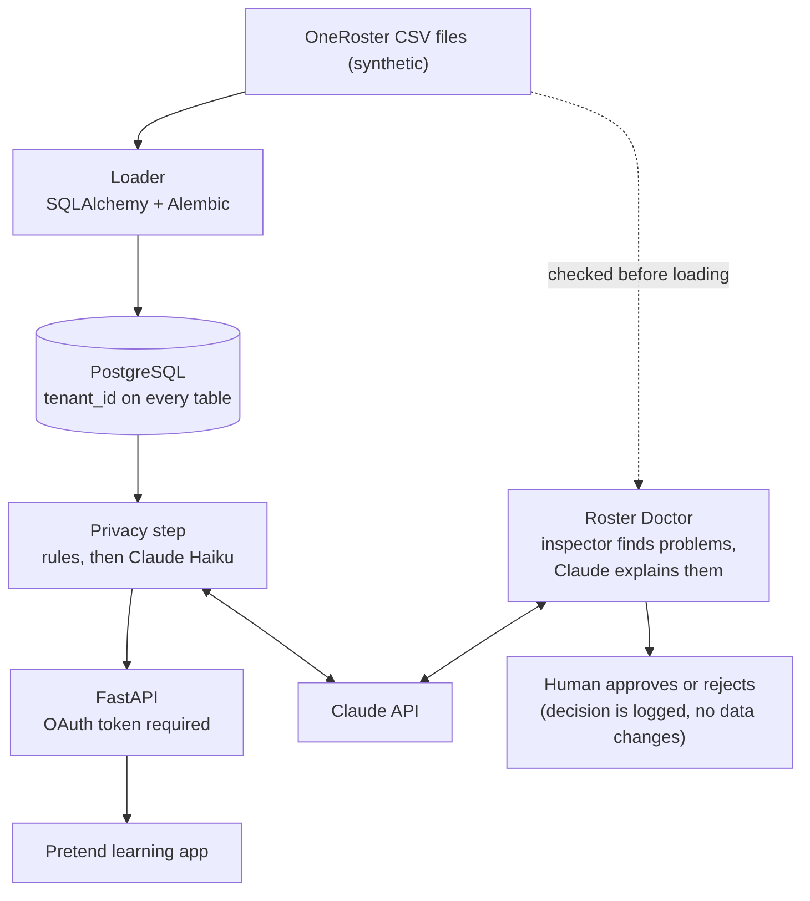

# ai-roster-privacy-pipeline

[](https://github.com/tobifotis/ai-roster-privacy-pipeline/actions/workflows/tests.yml)

AI-powered pipeline that redacts student PII from OneRoster data before it reaches third-party apps.

**Status:** all pieces built (Day 5 of 5). Demo recording is next.

## The problem

Schools keep student records in a system like PowerSchool. Learning apps like IXL need some of that data, but not the private parts. Teacher notes are the hard case: a note like "Maria's mom Sarah called about the bus" has a student name, a parent name, and sometimes a phone number or home address buried in free text.

This project is a small version of that flow. It loads synthetic OneRoster student data into PostgreSQL (one separate tenant per district), hides private details before the data reaches a pretend learning app, and serves the cleaned data through an API that requires an OAuth login. Before a roster file is loaded, an AI agent called Roster Doctor checks it, explains any problems in plain English, and suggests a fix, but a human approves any change and the agent can never edit data itself.

## Architecture

<!-- ```mermaid
flowchart LR
    A["OneRoster CSV files (synthetic)"] --> B["Loader<br/>SQLAlchemy + Alembic"]
    B --> C[("PostgreSQL<br/>tenant_id on every table")]
    C --> D["Privacy step<br/>rules, then Claude Haiku"]
    D --> E["FastAPI<br/>OAuth token required"]
    E --> F["Pretend learning app"]
    D <--> X["Claude API"]
    A -. "checked before loading" .-> G["Roster Doctor<br/>inspector finds problems,<br/>Claude explains them"]
    G <--> X
    G --> H["Human approves or rejects<br/>(decision is logged, no data changes)"]
``` -->




Presidio is used only in the scoring comparison, not in the pipeline.

## Build status

| Piece | Status |
| --- | --- |
| Synthetic OneRoster data generator | Done |
| PostgreSQL in a container | Done |
| Database models and Alembic migrations | Done |
| CSV loader with one tenant per district | Done |
| Privacy step (rules, Claude Haiku, Presidio comparison) | Done |
| Accuracy scoring (recall and precision) | Done |
| FastAPI roster endpoint | Done |
| OAuth 2.0 client credentials login with signed tokens | Done |
| Tests (pytest) and GitHub Actions | Done |
| Live redaction demo command | Done |
| Pretend learning app | Done |
| Roster Doctor agent (inspector, Claude explainer, human approval) | Done |
| Demo recording | Planned |

## Run it yourself

You need Python 3.12 (installed with [uv](https://docs.astral.sh/uv/)) and Podman or Docker.

```bash
# 1. Python environment and libraries
uv venv --python 3.12 .venv
source .venv/bin/activate
uv pip install -r requirements.txt

# 2. Start PostgreSQL (use "docker compose up -d" if you use Docker)
podman-compose up -d

# 3. Generate the synthetic data, create the tables, and load the data
python app/generate_synthetic_data.py
alembic upgrade head
python -m app.load_data

# 4. Score the three privacy approaches (needs a Claude API key, see below)
export ANTHROPIC_API_KEY="your-key-here"
python -m app.score_llm 160

# 5. Clean every note once with Claude and save the result
python -m app.redact_notes
```

The API key is read from an environment variable and is never stored in a file. Steps 4 and 5 make about 160 small Claude Haiku calls each, which costs a cent or two.

## The API and the login

The API never returns names, emails, phone numbers, or birthdates. Each student comes back with only an ID, a grade, class IDs, and cleaned notes. A note without a cleaned copy is not served at all (fail closed).

Apps log in with the OAuth 2.0 client credentials flow. Each registered app is tied to one district, and its token only opens that district.

```bash
# Register an app (prints its secret once; only a hash is stored)
python -m app.register_client pretend-learning-app district_a "Pretend Learning App"
export PRETEND_APP_SECRET="paste-the-secret-here"

# Start the API with a signing key for the tokens
export ROSTER_JWT_SECRET="$(python -c 'import secrets; print(secrets.token_urlsafe(48))')"
uvicorn app.api:app --reload
```

In a second terminal:

```bash
# Log in and get a one-hour token
TOKEN=$(curl -s -X POST localhost:8000/oauth/token \
  -d grant_type=client_credentials -d client_id=pretend-learning-app \
  -d client_secret="$PRETEND_APP_SECRET" | python -c "import sys, json; print(json.load(sys.stdin)['access_token'])")

# Read the cleaned roster for the app's own district
curl -s -H "Authorization: Bearer $TOKEN" localhost:8000/tenants/district_a/students
```

| Request | Result |
| --- | --- |
| No token, a garbage token, a forged token, or an expired token | 401 |
| A valid token asking for a different district (or a district that does not exist) | 403 |
| A valid token asking for its own district | 200 with the cleaned roster |

An unknown district returns 403, not 404, so an app cannot discover which districts exist. FastAPI also serves a live, clickable page at `http://localhost:8000/docs`.

### The pretend learning app

`app/pretend_app.py` plays the part of a customer app. It logs in, gets a token, and asks for its district's roster, exactly as a real app would. With the API running and `PRETEND_APP_SECRET` set:

```bash
python -m app.pretend_app
```

```
Logged in as pretend-learning-app. Token received (valid for 1 hour).

Received 80 students for district_a. First three:

  district_a-student-1-001  grades=6  classes=3
      note: Please call [PII] at [PHONE] about [PII]'s absence.
  district_a-student-1-002  grades=2  classes=3
      note: Reminder: library books are due Friday.
  district_a-student-1-003  grades=2  classes=3
      note: [PII]'s mom [PII] called about the bus.
```

## Live demo

```bash
python -m app.demo_redact "Please call Maria Lopez at 817-555-1234 about her son Jake's absence."
# AFTER: Please call [PII] at [PHONE] about her son [PII]'s absence.

python -m app.demo_redact   # type notes at the prompt
```

## Roster Doctor

When a roster file is wrong, the loader stops with a message like `Invalid isoformat string` and no row number. Roster Doctor is the agent that turns a problem like that into something a school office worker can act on. It has two halves, kept apart on purpose:

1. **The inspector** (`app/roster_check.py`) is plain code with no AI. It reads the CSV files before anything is loaded and lists every problem with the file, the spreadsheet row, the column, and the value. Because plain code decides what is wrong, the agent cannot invent problems.
2. **The explainer** (`app/roster_doctor.py`) sends only the inspector's list to Claude Haiku (IDs and dates, never names or emails) and asks for a plain-English explanation and one suggested fix per problem. If Claude's reply is not a clean list with one answer per problem, nothing is shown (fail closed).

A person then answers `y` or `n` for each suggestion. The only thing the Doctor ever writes is one line per decision in `logs/doctor_decisions.jsonl`. It has no code that edits a CSV file or the database, so a person makes any approved fix by hand.

To try it, make a practice copy of district A with two planted mistakes (a date written 08/15/2026, and an enrollment pointing to a student who does not exist), then run the Doctor (needs `ANTHROPIC_API_KEY`):

```bash
python -m app.make_broken_sample
python -m app.roster_doctor
```

```
samples/broken_district: 2 problem(s) found by the inspector.

enrollments.csv row 2, beginDate = '08/15/2026'
  What happened: The start date in row 2 is written as month/day/year, but the file needs year-month-day. The checker cannot read it in the required format.
  Suggested fix: In enrollments.csv row 2, change the beginDate from 08/15/2026 to 2026-08-15.
  Approve this suggestion? [y/n]

enrollments.csv row 3, userSourcedId = 'district_a-student-9-999'
  What happened: Row 3 refers to a student ID that does not appear in users.csv, so the system cannot match the enrollment to a person. The ID may have a typo, or the student may be missing from the users file.
  Suggested fix: Search users.csv for the student's name, compare the ID there with 'district_a-student-9-999' in row 3 and correct any typo, or add the missing student to users.csv if they are not listed.
  Approve this suggestion? [y/n]
```

Claude did not guess the missing student's ID. It told the reader what to check instead.

## Tests

```bash
# one time: create a separate practice database next to the real one
podman exec -it ai-roster-privacy-pipeline_db_1 psql -U roster -d roster -c "CREATE DATABASE roster_test;"

pytest -v
```

The 53 tests cover login, token checks (missing, garbage, forged, expired, wrong scope), district separation, the privacy guarantees of the API, the phone, email, and date rules, and Roster Doctor (the inspector, replies from a fake Claude including unusable ones, and the human approval step). The API tests run against a real PostgreSQL database named `roster_test`, which is erased and rebuilt from the Alembic migrations on every run, and a safety guard refuses to erase any database whose name does not end in `_test`. The tests never call Claude, so they are free, fast, and give the same answer every time. GitHub Actions runs them on every push, with a throwaway PostgreSQL started for the job.

## Synthetic data

All data is synthetic, generated with Faker using a fixed seed (42), so every run produces the same files. There are two districts, each with 3 orgs, 88 users (8 teachers and 80 students), 8 classes, 248 enrollments, and 80 teacher notes. The CSVs follow a simplified OneRoster layout. `notes.csv` is not part of OneRoster. It holds free-text notes plus a `pii_labels` column, an answer key that lists the private details in each note and is used for scoring. `samples/broken_district` is a deliberately broken copy of district A used to practice Roster Doctor, kept outside `data/` so the normal loader never reads it.

## Results

I scored three ways of hiding private details on 160 synthetic teacher notes (242 private details in total, listed in the answer key).

| Approach | Recall (private details caught) | Precision (hidden items that were truly private) |
| --- | --- | --- |
| Rules only (regex) | 18.2% | 100% |
| Presidio (free, open source) | 97.5% | 80.6% |
| Claude Haiku | 100% | 100% |

- **Rules** reliably catch phones, emails, and dates, but cannot recognize names or addresses.
- **Presidio** catches almost everything, but wrongly hides harmless time words like "Friday" and "today", and misses phone numbers with extensions.
- **Claude Haiku** read each note for meaning and got both scores right. Scoring all 160 notes cost about a cent or two.

**Caveat:** the notes were generated from a small set of templates, so these scores will be higher than on real teacher notes, which are messier. Real-world accuracy would need testing on approved real data.

Run it yourself: `python -m app.score_llm 160` (needs an `ANTHROPIC_API_KEY` environment variable).

## Limitations

- The privacy step sends note text to the Claude API. That is fine for synthetic data, but production use with real student records would need an agreement that covers student data, or a locally hosted model.
- Scores come from template-generated notes and will be lower on real, messier notes.
- Tokens are signed with one shared key (HS256) and cannot be revoked before they expire in one hour. A production system would use asymmetric keys and an identity provider.
- The cleaned notes are made once and saved. If the cleaning rules or the prompt change, `app.redact_notes` has to be run again on the notes it already cleaned.
- Roster Doctor's inspector checks two kinds of problems in `enrollments.csv` (dates in the wrong format and enrollments that point to a person who is not in `users.csv`). It is run by hand and is not yet wired into the loader, and it only checks enrollments so far. Other files and other kinds of problems would need more checks.
- Roster Doctor records decisions but does not apply fixes. A person edits the files.


## License

MIT