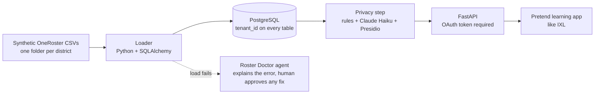

# ai-roster-privacy-pipeline

AI-powered pipeline that redacts student PII from OneRoster data before it reaches third-party apps.

> Status: in progress (Day 2 of 5 complete). All data in this repo is synthetic. No real students or real personal information is used.

## The problem

Schools keep student records in a system like PowerSchool. Learning apps like IXL need some of that data, but not the private parts. This project loads school roster data, hides the private details, and gives an app only what it needs. If a roster file fails to load, an AI agent explains why.

## How it works



## Build status

| Piece | Status |
| --- | --- |
| Synthetic OneRoster data generator | Done |
| PostgreSQL with Podman or Docker Compose | Done |
| Database models and Alembic migrations | Done |
| CSV loader with one tenant per district | Done |
| Privacy step (rules, Claude Haiku, Presidio) | Planned |
| FastAPI with OAuth | Planned |
| Roster Doctor agent | Planned |
| Tests and GitHub Actions | Planned |
| Accuracy scores and demo | Planned |

## Run it yourself

You need Python 3.12 and Podman or Docker.

```bash
uv venv --python 3.12 .venv
source .venv/bin/activate
uv pip install -r requirements.txt

podman-compose up -d          # or: docker compose up -d
python app/generate_synthetic_data.py
alembic upgrade head          # create the tables
python -m app.load_data       # load both districts
```

## Synthetic data

`app/generate_synthetic_data.py` writes two synthetic school districts to `data/` in a simplified OneRoster CSV layout. `notes.csv` holds free-text teacher notes with names, phones, and addresses hidden inside, plus a `pii_labels` column that lists the private details. That column is the answer key for scoring the privacy step.

## Results

Coming soon: precision and recall for each privacy approach, including where each one fails.

## How I built this with AI

Coming soon.

## License

MIT